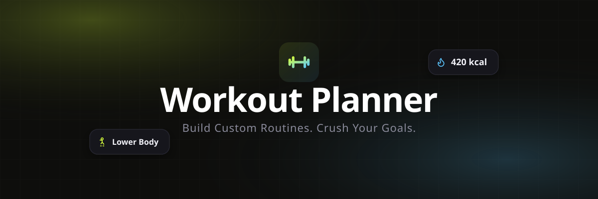

<p align="center">
  
</p>

# Workout Planner

**A fast, zero-dependency workout planner and voice-guided interval timer that runs in any browser.**

[](https://workout.chinmayjha.tech)
[](https://chinmayjha.tech)

## Overview

Build a routine from a 143-exercise gym and bodyweight library (or start from a ready-made routine), run it with a hands-free timer and voice coach, then watch your streak and 30-day activity heatmap grow. Everything runs in the browser with vanilla HTML, CSS and JavaScript. There is no backend, no account and no tracking: your data stays on your device.

## Features

**Planning**

- Exercise library of 143 moves across chest, back, shoulders, arms, legs, glutes, core, cardio, full body and stretching. Filter by muscle group and by equipment (bodyweight, dumbbell, barbell, machine, cable, kettlebell, other), or search by name, muscle or gear.
- **Quick-start routines:** Push Day, Pull Day, Leg Day, 10-Min HIIT, Home Bodyweight, Core Crusher and Dumbbell Full Body, plus a 4-minute Warm-Up and a 5-minute Cool-Down, load in one tap (you are asked before your current plan is replaced).
- **My routines:** save your current plan under a name (up to 12) and reload or delete it later.
- **Share link:** copy a link that contains your plan. Anyone who opens it is asked before it replaces their plan. Invalid or tampered links are rejected.
- Drag-and-drop ordering and per-exercise time.
- Strength moves can switch to **Reps** mode with a target rep count. Holds and cardio stay timed.
- Adjustable rounds, rest between exercises, a separate break between rounds, prep time and an adaptive rest button.
- Live time and calorie estimate for the plan.

**Workout**

- Prep, work and rest phases with a live timer, progress bar and phase colours.
- Voice coaching split into three switches: **Announcements**, **Form coaching** and **Pacing & chimes** (beeps and a halfway cue on timed exercises of 20s or more).
- **Round-break panel:** between rounds, adjust the time per exercise and the number of rounds for that workout only (your saved plan is untouched).
- **Back button** replays the previous exercise.
- Screen wake lock keeps the display on during a workout.
- Ending early still saves your time and calories and takes you to the share screen.
- "How did that feel?" rating (Light / Hard / Brutal) after every session.

**Profile**

- Lifetime stats, current and best streak, and a 30-day heatmap with tap/hover details.
- A streak chip on the Plan tab shows your streak and whether you have trained today.
- **Streak Savers:** earn 1 for every 5 days with a completed workout (max 3). A saver automatically covers missed days so a streak survives, but only when it can cover the whole gap.
- JSON backup (export / import) and a hold-to-confirm "clear all data" button.
- Optional name and body weight (kg or lb, set up from a dismissible card) for greetings and calorie estimates. Calories use the standard MET formula.
- A help popup with Shortcuts, a searchable Exercise guide and the FAQ.

**Share**

- Generates a 1080x1920 story image (Canvas API) with your time, calories, exercises and rating. Uses the native share sheet on supported phones and downloads the image elsewhere.

**Offline and SEO**

- Installable PWA with a service worker, so the planner works offline.
- Keyword-focused title and description, a visible FAQ with FAQPage structured data, `robots.txt` and `sitemap.xml`.

**Keyboard shortcuts**

| Key     | Action                                   |
| ------- | ---------------------------------------- |
| `Space` | Pause / resume (or mark reps done)       |
| `→`     | Skip phase                               |
| `M`     | Mute / unmute                            |
| `Esc`   | Close a popup, or ask to end the workout |
| `?`     | Open help and the form video glossary    |

## How streaks work

- A day counts once its sessions add up to at least 60 seconds. Dates use your local timezone.
- Several sessions in one day count as one active day.
- The "5 to your next saver" counter counts **days**, not workouts. A day adds one only if it has a completed workout (finished, at least 60 seconds, and at least half its planned time). A second workout the same day adds nothing.
- If you miss a day and hold a saver, it is spent automatically and your streak and counter carry on.
- If you miss a day and have no saver, your streak **and** the 5-day counter reset to zero.
- Missed days are resolved when you open the app and again before each session is saved, so leaving a tab open overnight cannot cost you a saver.

## Project structure

```
index.html        page markup (Plan, Workout and Profile tabs, modals, FAQ)
styles.css        all styling
app.js            planner, workout engine, audio, share card, shortcuts
js/store.js       saved data, migration, local-date logging, streak engine
js/profile.js     Profile tab: heatmap, savers, backup, clear data
js/exercises.js   extended exercise library, filters and quick-start routines
sw.js             service worker (offline support)
manifest.json     PWA manifest
robots.txt        crawler rules
sitemap.xml       sitemap for search engines
assets/           banner, social image and app icons
404.html          not-found page
```

## Your data

Everything is stored in your browser's `localStorage` (`forge_state_v6` for the planner and settings, `workout_state_v7` for sessions and streaks). Nothing is sent anywhere. Use **Profile > Backup** to export before clearing browser data or switching devices.

## Getting started

```
git clone https://github.com/chinmayjha/Workout-planner.git
cd Workout-planner
```

Open `index.html` in a browser. No build step or server is required. (The service worker only registers when the site is served over `http(s)`.)

## Deployment

The site is hosted on GitHub Pages. To use a custom subdomain, add a `CNAME` record pointing to `chinmayjha.github.io` at your DNS provider and put the domain in the repository's `CNAME` file.

When you change any cached file, bump `CACHE` in `sw.js` (for example `workout-planner-v3`) so returning visitors get a clean refresh. New files must also be added to the `SHELL` list in `sw.js` to work offline.

## Adding exercises

Add one line to the `ROWS` list in `js/exercises.js`:

```
"id|Name|category|mode|cue"
```

```
"cablelift|Cable Lift|core|r|Pull diagonally across your body with a braced core."
```

- `id`: unique, lowercase, never changed once published (saved plans use it).
- `category`: `upper`, `lower`, `core`, `cardio`, `full` or `flex` (stretching).
- `mode`: `r` for reps (can switch to timed), `t` for timed cardio, `h` for a timed hold, `s` for a timed stretch.
- The muscle group and equipment filters are assigned automatically from the exercise name. If one is misfiled, adjust the keyword rules in `GR` (muscle group) or `QR` (equipment) in the same file.
- New exercises reuse a generic icon for their category. For a custom icon, add a matching key to `EX_ICONS` in `app.js`.

The original 25 exercises live in the `EXERCISES` array in `app.js`. Their format is an object:

```
{
  id: "new-exercise",
  name: "Your New Exercise",
  cat: "upper", // upper, lower, core, cardio, full
  cue: "A brief tip for form and execution.",
  time: 45, // default seconds
  tts: "How the voice coach should say the name"
}
```

To allow Reps mode for one of these, add its `id` to the `REPS_OK` set.

## Roadmap

- New visual identity and workout screen, light/dark theme switch
- Landing page and per-exercise pages for search
- A workout generator
- Touch-friendly drag reordering and a drift-proof timer
- Optional weight history with a trend line
- Roomier plan cards on small phones
- Merge planner and activity data into one storage key

## About the Author

**Chinmay Jha** *Student • Web Developer • Freelancer*

I am a 17-year-old web developer from India. I started coding at 11, and I specialize in building fun, functional, and highly polished web projects and user interfaces.

Portfolio: [chinmayjha.tech](https://chinmayjha.tech) GitHub: [@chinmayjha](https://github.com/chinmayjha) Email: <contact@chinmayjha.tech>

## License

Released under the [MIT License](LICENSE). Feel free to fork, modify, and use it in your own projects.
